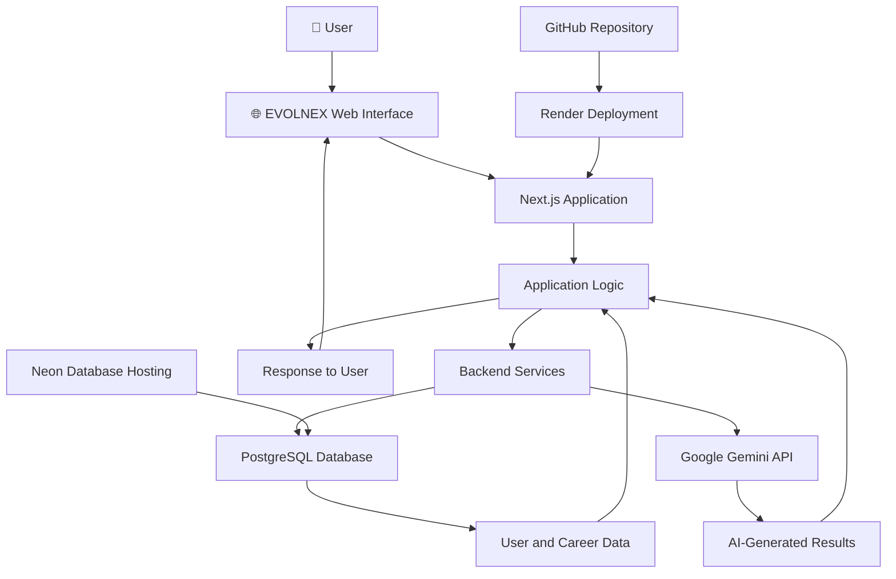
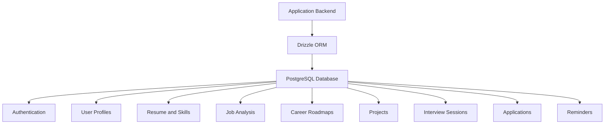
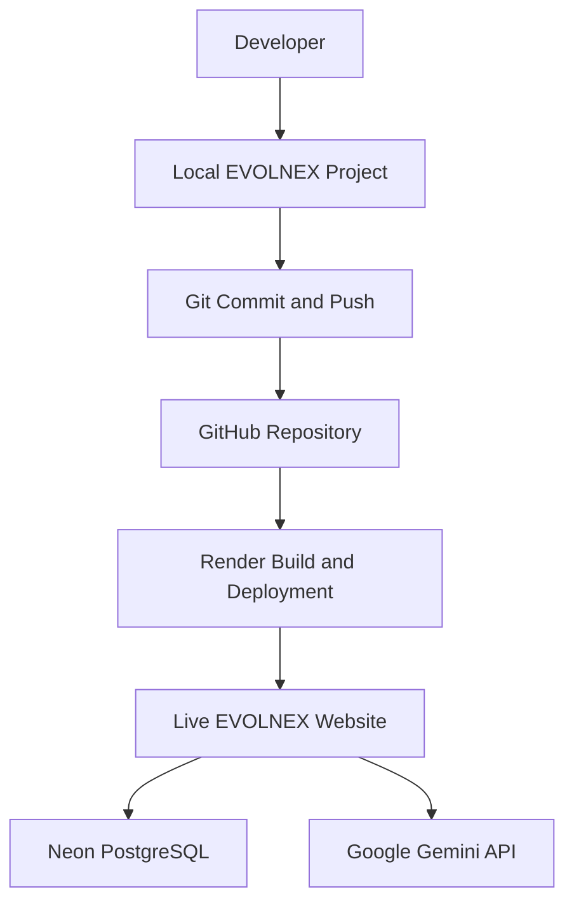

# 🚀 EVOLNEX
### AI-Powered Career Intelligence Platform

<p align="center">
  <strong>Discover Your Potential. Build Your Skills. Shape Your Future.</strong>
</p>

<p align="center">
  <a href="https://evolnex.onrender.com"><strong>🌐 LIVE APPLICATION</strong></a>
  &nbsp; • &nbsp;
  <a href="https://github.com/Saisaran-2007/EVOLNEX">GitHub Repository</a>
</p>

<p align="center">
  
  
  
  
  
  
</p>

---

## 📌 1. Project Overview

**EVOLNEX** is an AI-powered career intelligence platform designed to support individuals in understanding their professional potential, organizing their career development, and preparing for future opportunities.

The platform combines modern web technologies, structured PostgreSQL data management, and Google Gemini AI integration to provide an extensible environment for career development.

### 🎯 Project Objectives

- Support personalized career development.
- Organize professional profiles and resume information.
- Provide AI-assisted career and job analysis capabilities.
- Support skill development and learning roadmaps.
- Organize projects and job applications.
- Provide interview preparation functionality.
- Help users manage career-related tasks and reminders.

---

## ✨ 2. Core Modules

The project database schema includes the following functional areas:

| Module | Description |
|---|---|
| User Management | User accounts and session management |
| Profiles | Professional profile information |
| Resume Management | Resume records and information |
| Skills | Skill tracking and organization |
| Job Analysis | Job-related analysis records |
| Career Roadmaps | Structured career development plans |
| Roadmap Tasks | Individual roadmap activities |
| Projects | Project portfolio records |
| Interview Preparation | Interview sessions and questions |
| Applications | Job application tracking |
| Application Events | Application activity history |
| Reminders | Career-related reminders |

*The exact functionality available to visitors depends on the implemented application screens and backend routes.*

---

## 🧰 3. Technology Stack

### Frontend

| Technology | Purpose |
|---|---|
| Next.js 16 | React application framework |
| React 19 | Component-based user interface |
| TypeScript | Type-safe application development |
| CSS | Interface styling |

### Backend

| Technology | Purpose |
|---|---|
| Next.js server-side functionality | Backend application logic |
| Node.js | JavaScript runtime |
| Google Gemini API | AI-powered generation and analysis |
| Fetch API | Communication with external AI services |

### Database

| Technology | Purpose |
|---|---|
| PostgreSQL | Relational database |
| Neon | Hosted PostgreSQL infrastructure |
| Drizzle ORM | Database queries and schema management |
| Drizzle Kit | Database migrations and management |

### Deployment & Development

| Technology | Purpose |
|---|---|
| Git | Version control |
| GitHub | Source code hosting |
| Render | Application hosting |
| npm | Package management |
| VS Code | Development environment |

---

## 🏗️ 4. System Architecture

The following diagram illustrates the overall application architecture.



### Architecture Explanation

1. Users access EVOLNEX through the web interface.
2. The Next.js application processes application requests.
3. Backend services handle application logic.
4. PostgreSQL stores structured application data.
5. Google Gemini provides AI-generated responses when configured.
6. Results are returned to the web interface.
7. GitHub maintains the source code, while Render hosts the deployed application.

---

## 🗄️ 5. Database Architecture

EVOLNEX uses PostgreSQL with Drizzle ORM.

The current schema defines 15 tables:

| Category | Tables |
|---|---|
| Authentication | `users`, `sessions`, `auth_tokens` |
| User Information | `profiles`, `resumes`, `skills` |
| Career Development | `job_analyses`, `roadmaps`, `roadmap_tasks` |
| Portfolio | `projects` |
| Interview Preparation | `interview_sessions`, `interview_questions` |
| Job Applications | `applications`, `application_events` |
| Productivity | `reminders` |

### Database Flowchart



---

## 🤖 6. AI Integration

EVOLNEX includes a server-side Google Gemini integration.

### AI Technology

- Google Gemini Generative Language API
- Server-side API requests
- JSON-based structured responses
- Model fallback support
- Response validation
- Request timeout handling
- Error handling for unavailable models and API quotas

### Environment Variables

| Variable | Purpose |
|---|---|
| `GEMINI_API_KEY` | Google Gemini API authentication |
| `GOOGLE_API_KEY` | Alternative Google API key name |
| `GEMINI_MODEL` | Optional primary Gemini model |
| `GEMINI_FALLBACK_MODELS` | Optional fallback model list |
| `GEMINI_TIMEOUT_MS` | Optional request timeout |
| `EVOLNEX_DISABLE_AI` | Optional AI disable switch |

AI functionality requires a valid API key and available model access.

---

## ⚙️ 7. Installation and Local Setup

### Prerequisites

Install the following:

- Node.js
- npm
- PostgreSQL database
- Git
- Google Gemini API key (for AI features)

### Step 1: Clone the Repository

```bash
git clone https://github.com/Saisaran-2007/EVOLNEX.git
```

### Step 2: Open the Project

```bash
cd EVOLNEX
```

### Step 3: Install Dependencies

```bash
npm install
```

### Step 4: Configure Environment Variables

Create a `.env.local` file in the project root.

```env
DATABASE_URL=your_postgresql_connection_string
GEMINI_API_KEY=your_gemini_api_key
```

Replace the example values with your own credentials.

**Never upload `.env.local` or real API keys to GitHub.**

### Step 5: Run Database Migrations

```bash
npx drizzle-kit migrate --config=drizzle.config.ts
```

### Step 6: Start Development Server

```bash
npm run dev
```

### Step 7: Open EVOLNEX

```text
http://localhost:3000
```

---

## 🌐 8. Deployment Architecture

EVOLNEX is deployed using GitHub, Render, and Neon.



### Deployment Services

| Service | Provider |
|---|---|
| Source Code | GitHub |
| Web Application | Render |
| PostgreSQL Database | Neon |
| AI Services | Google Gemini |

### Live Application

🌐 **https://evolnex.onrender.com**

---

## 🔐 9. Security Considerations

- Keep database credentials in environment variables.
- Never commit API keys or passwords.
- Keep `.env.local` and `.env.production` out of Git.
- Use server-side handling for sensitive API requests.
- Use secure database connections.
- Rotate credentials if they are accidentally exposed.

---

## 📁 10. Project Structure

```text
EVOLNEX/
│
├── backend/
│   ├── db/
│   │   ├── index.ts
│   │   └── schema.ts
│   └── lib/
│       └── ai/
│           └── gemini.ts
│
├── drizzle/
│   └── Database migrations
│
├── docs/
│
├── frontend/
│
├── public/
│
├── scripts/
│
├── src/
│   └── app/
│       └── Application routes and pages
│
├── .env.example
├── .gitignore
├── drizzle.config.ts
├── next.config.ts
├── package.json
├── package-lock.json
└── README.md
```

---

## 🚀 11. Future Enhancements

Potential future development areas include:

- Enhanced career recommendation systems.
- More advanced resume analysis.
- Personalized learning recommendations.
- Expanded interview preparation tools.
- Career analytics and progress visualization.
- Additional job opportunity integrations.
- Improved user experience and accessibility.

---

## 👨‍💻 12. Developer

**Sai Saran R**

GitHub: [@Saisaran-2007](https://github.com/Saisaran-2007)

Project: [EVOLNEX](https://github.com/Saisaran-2007/EVOLNEX)

Live Application: [https://evolnex.onrender.com](https://evolnex.onrender.com)

---

## 📜 13. License

No license has been specified for this repository yet. Please contact the repository owner regarding usage and distribution permissions.

---

<p align="center">
  <strong>EVOLNEX — Empowering the Next Generation of Career Intelligence.</strong>
</p>

<p align="center">
  Built with ❤️ by Sai Saran R
</p>
